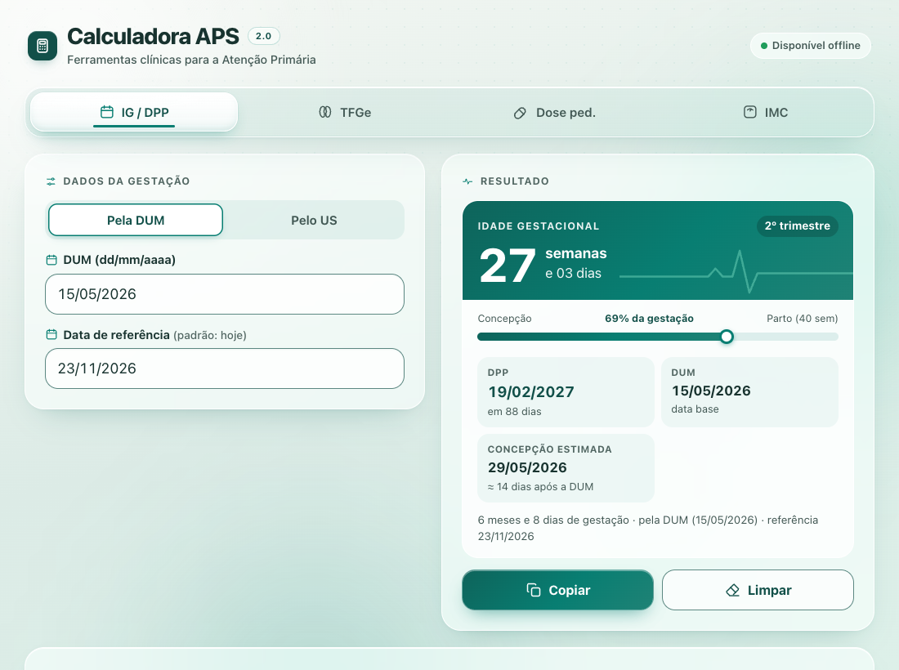
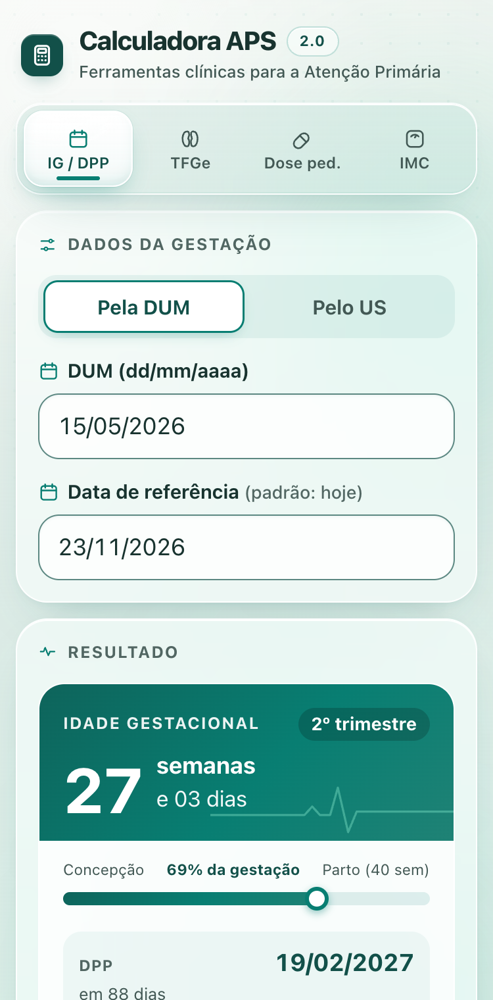

# Calculadora APS 2.0

Ferramentas clínicas para a Atenção Primária: idade gestacional com agenda do pré-natal, função renal, dose pediátrica e IMC.
Rápida, funciona sem internet e não pede cadastro.

**Acesse:** https://adalbertozauli.github.io/calculadora-aps-v2/

A versão 1 continua disponível, sem mudanças, em https://adalbertozauli.github.io/calculadora-aps/.

| Desktop | Celular |
|---|---|
|  |  |

## Calculadoras

| Aba | O que calcula | Exemplo do texto copiado |
|---|---|---|
| **IG / DPP** | Idade gestacional e data provável do parto pela DUM ou por um ultrassom. Mostra o trimestre, o progresso da gestação e a agenda do pré-natal (Caderneta da Gestante 2026), com consultas, exames e vacinas de cada fase. | `IG 23 semanas e 05 dias, 2º trimestre. DPP 08/10/2026.` |
| **TFGe** | Taxa de filtração glomerular pela CKD-EPI 2021 (sem coeficiente de raça), com o estágio da DRC. Com o peso, calcula também a depuração de creatinina por Cockcroft-Gault. | `TFGe 92 mL/min/1,73 m² (CKD-EPI 2021), estágio G1. ClCr 88 mL/min (Cockcroft-Gault, peso 70 kg)` |
| **Dose ped.** | Dose pediátrica por peso: mg/dia, mg por tomada e mL por tomada. Se você informar a dose máxima diária, a calculadora limita a dose e mostra um alerta. | `Dose: 20 kg × 50 mg/kg/dia = 1000 mg/dia. 333 mg por tomada, 3x/dia (8/8 h) = 6,7 mL por tomada (apresentação 50 mg/mL).` |
| **IMC** | Índice de massa corporal com a classificação da OMS. A altura pode ser digitada em metros ou centímetros. | `IMC 22,9 kg/m² (eutrófico)` |

Nas quatro calculadoras:

- O resultado aparece enquanto você digita.
- **Copiar** põe no prontuário um texto curto e pronto.
- **Limpar** apaga os campos.
- Valores impossíveis ou fora da faixa aparecem em vermelho, junto ao campo, com o motivo.

## O que há de novo na 2.0

- **Painel em cartões de vidro:** em telas largas, *Dados* e *Resultado* ficam lado a lado. Na janela estreita ao lado do prontuário e no celular, ficam um embaixo do outro.
- **Abas com lente de vidro animada:**
  - Ao trocar de calculadora, a lente desliza até a aba escolhida em 300 a 450 ms.
  - Em cliques rápidos, cada troca parte de onde a lente está.
  - No celular, as quatro abas cabem numa linha e ficam presas no topo ao rolar.
- **Paleta Jade clínico e contraste conferido:**
  - Texto com pelo menos 4,5:1 e campos, botões e foco com pelo menos 3:1, medidos sobre o vidro real.
  - Os nomes das abas mantêm o contraste mesmo com a lente passando por cima.
  - As cores de alerta são as mesmas da versão 1.
- **Teclado:**
  - Tab entra na aba ativa.
  - As setas ← → trocam de calculadora, e Home e End vão para a primeira e a última.
  - Tab de novo entra no primeiro campo.
- **Menos movimento:** com essa preferência ligada no sistema, a lente muda de lugar sem animação.
- **Indicador "Disponível offline"** no cabeçalho, quando a cópia sem internet está pronta.

Fórmulas, validações, avisos, alertas e textos copiados são os mesmos da versão 1. O teste de paridade, descrito abaixo, confere isso.

## Como usar

- **No navegador:** abra o endereço acima. Funciona em qualquer navegador atual, no computador ou no celular.
- **Como app no celular:**
  - iPhone: no Safari, toque em *Compartilhar → Adicionar à Tela de Início*.
  - Android: no Chrome, abra o menu ⋮ e toque em *Adicionar à tela inicial*.
  - O app abre em tela cheia com o nome **Calc APS 2**.
- **Sem internet:** depois de abrir uma vez com internet, a calculadora continua funcionando sem conexão. O indicador mostra "Sem internet · usando cópia salva".
- **Sem servidor:** `calculadora-aps.html` abre sozinho, até por duplo clique. Assim só o modo offline e o "Adicionar à Tela de Início" ficam de fora.

## Arquivos

```
calculadora-aps.html   a aplicação inteira: estilo, ícones e código num arquivo só
index.html             página inicial do site, que abre a calculadora
sw.js                  modo offline (cópias com o prefixo "calculadora-aps-v2-")
manifest.webmanifest   nome, ícone e cores do app instalado no celular
icones/                ícones do app
docs/                  capturas de tela usadas neste README
testes/paridade.mjs    compara a 2.0 com a versão 1
testes/referencia-v1.html  cópia congelada da versão 1, usada pelo teste
```

Dentro de `calculadora-aps.html`:

- `<script id="calculos">` contém só as contas, copiadas sem alteração da versão 1.
- `<script id="interface">` lê os campos e mostra o resultado.
- As cores ficam em variáveis no início do `<style>`.

## Testes

O teste de paridade precisa do [Node.js](https://nodejs.org/) 18 ou mais recente:

```bash
node testes/paridade.mjs
```

O teste roda as quatro calculadoras da 2.0 e da versão 1 com mais de 20 mil entradas: os exemplos acima, valores aleatórios, vazios, inválidos e nos limites. Ele compara o texto copiado, os avisos, os alertas e a agenda. Também confere que o bloco de cálculos é idêntico, caractere por caractere. O resultado esperado é:

```
OK: 20006/20006 casos iguais à versão 1
```

Para testar localmente com o modo offline, sirva a pasta e abra `http://localhost:8000/`:

```bash
python3 -m http.server 8000
```

## Publicar (GitHub Pages)

O repositório previsto é **adalbertozauli/calculadora-aps-v2**, e o endereço será **https://adalbertozauli.github.io/calculadora-aps-v2/**.
Todos os caminhos internos são relativos, então o site funciona nesse subcaminho sem nenhum ajuste.

1. Rode o teste de paridade, que deve terminar com `OK`.
2. Na pasta do projeto, crie o repositório e envie os arquivos:

   ```bash
   git init -b main
   git add .
   git commit -m "Calculadora APS 2.0"
   gh repo create adalbertozauli/calculadora-aps-v2 --public --source . --push --description "Calculadora APS 2.0: IG/DPP com agenda do pré-natal, TFGe (CKD-EPI 2021 e Cockcroft-Gault), dose pediátrica e IMC. Offline, sem cadastro."
   ```

3. Ative o GitHub Pages pela branch `main`, na raiz:

   ```bash
   gh api -X POST repos/adalbertozauli/calculadora-aps-v2/pages -f "source[branch]=main" -f "source[path]=/"
   ```

4. Depois de 1 ou 2 minutos, abra o endereço, confira as quatro calculadoras e teste no celular.

**Para atualizar depois:** edite os arquivos e rode o teste de paridade antes de enviar (`git commit` e `git push`). Se acrescentar ou renomear arquivos, atualize a lista `ARQUIVOS` em `sw.js` e troque a `VERSAO`, por exemplo de `v1` para `v2`.

Se usar outro nome de repositório, troque `calculadora-aps-v2` no `og:url` de `index.html` e de `calculadora-aps.html`.

### Convivência com a versão 1

As duas versões ficam no mesmo domínio (`adalbertozauli.github.io`), mas em pastas e escopos de service worker diferentes, sem mexer uma na outra:

- A 2.0 só cria e apaga cópias offline com o prefixo `calculadora-aps-v2-`.
- O `sw.js` da versão 1 apaga as cópias de outros nomes quando é ativado. Por isso, a 2.0 confere a própria cópia toda vez que abre com internet e guarda de novo o que faltar.
- **Risco que resta:** se a versão 1 for aberta ou atualizada e, depois disso, a 2.0 só for aberta sem internet, ela não abre offline até a próxima abertura com conexão.

## Privacidade

Nenhum dado é salvo nem enviado. Não há cookies, analytics, bibliotecas ou fontes externas.

## Aviso

Esta é uma ferramenta de **apoio** à decisão clínica e não substitui o julgamento do profissional de saúde. Confira sempre os resultados antes de registrar ou prescrever.

Desenvolvido por **Adalberto Zauli**, médico de família e comunidade.
